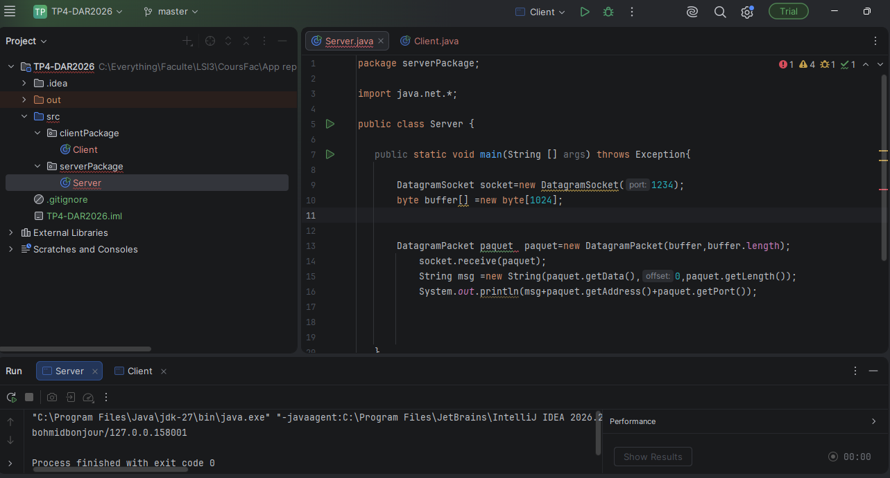
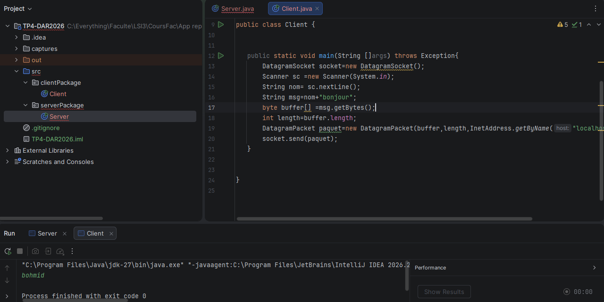

# TP 4 : Sockets en mode non-connecté UDP

**Nom :** Masmoudi 

**Prénom :** Ahmed

## Étape 2 : Chat Unidirectionnel et Test avec un Seul Client

Cette étape consiste à développer un serveur UDP qui écoute sur le port 1234 et un client qui permet à l'utilisateur de saisir son nom et d'envoyer des messages au serveur sous forme de datagrammes UDP. Le serveur affiche chaque message reçu ainsi que l'adresse IP et le port de l'expéditeur.

